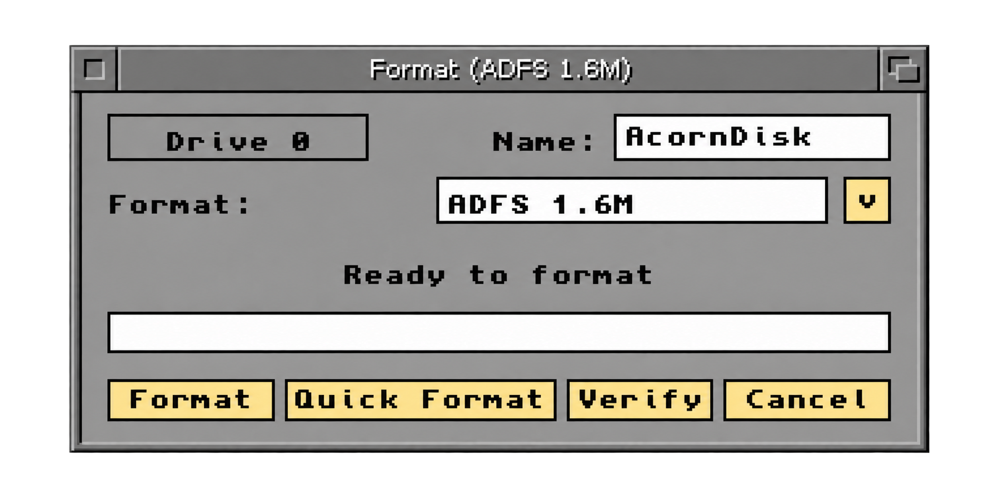
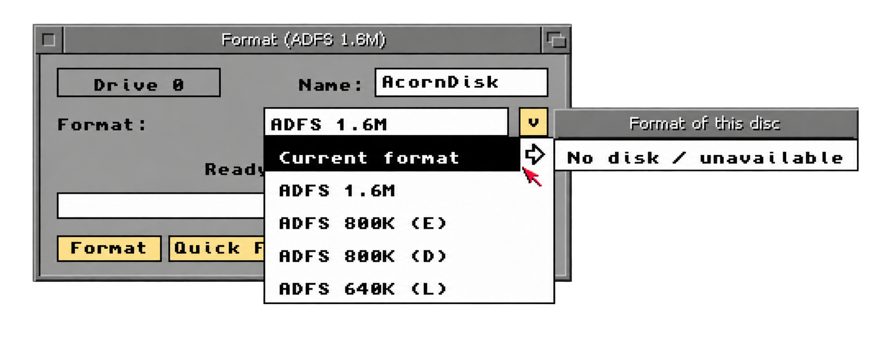

# CrossADFS for Amiga

Read and write Acorn ADFS floppy disks from Workbench, and format or verify them with **AcornFormat**. Developed as CrossAcorn; the filesystem is **CrossADFSFileSystem** and mounts the internal drive as **ADFS0:**.

**[Download the installer](https://github.com/MasterCatsUK/CrossADFS/releases/tag/v0.9.23)** · [Installation](docs/INSTALL.md) · [AcornFormat guide](docs/AcornFormat.txt) · [Compatibility and testing](docs/COMPATIBILITY.md)

This is the first public **test release**: CrossADFSFileSystem **0.9.23**, with AcornFormat **0.9.1**. Download **CrossAcorn-Setup-0.9.23.zip** from Releases, extract the complete drawer, and double-click **Install**. GitHub's green Code download contains this project page and documentation, rather than the installer.

## What it does

- Opens recognised ADFS disks in Workbench for files and folders, including subfolders.
- Supports ADFS L, D, E and F, with LongFiles support and RAM-based sprite icons retained.
- Installs AcornFormat and its green Acorn floppy icon in **SYS:Tools**.
- Adds Workbench **Format Disk** integration for the selected Acorn volume. Other volumes are passed to the original Amiga formatter.
- Offers **Format**, **Quick Format**, **Verify** and **Cancel**, with progress inside the main window: red while writing and dark green while verifying.
- Checks the inserted disk when entering **Current format** in the standalone format menu. Installed, running CrossMAC/CrossDOS handlers can supply Mac/PC identification for information only, including Mac 1.44MB.

## Formats

| Format | Capacity | Media and drive |
| --- | --- | --- |
| ADFS L | 640K | DD floppy, supported Amiga 3.5-inch drive |
| ADFS D | 800K | DD floppy, supported Amiga 3.5-inch drive |
| ADFS E | 800K | DD floppy, supported Amiga 3.5-inch drive |
| ADFS F | 1.6M | HD floppy and an Amiga HD drive |

F+ is not supported. Mac and PC formatting are not included.

## Requirements and test status

Classic Amiga, **68020 or later**, internal **DF0:**, and **Kickstart/Workbench 3.1 or later**. Uses integer code; no FPU is required. No ReAction, chooser.gadget, MUI or Coffin OS dependency.

Physical disk testing has been reported on **Workbench 3.2.1** with copied files and disk verification checked on an **Acorn A3010**. For 3.1 compatibility, the source/API audit and **40 automated m68k test runs** passed on 68020/68040 emulation. **A full stock Workbench 3.1 boot has not been tested.** Later Workbench releases have not each been independently boot-tested. See the [testing details](docs/COMPATIBILITY.md).

Workbench 3.1 uses the included standard four-colour icon fallback. Newer icon libraries can use the colour image; screen palette and theme affect its appearance.

## Install and open

1. Extract the complete installer ZIP on the Amiga and open its drawer.
2. Double-click **Install** and follow the Workbench Installer pages. Close Acorn files and Format windows first.
3. Restart once. The ADFS0 mount starts automatically; no StartCrossAcorn command is needed.
4. Open your system disk → **Tools → AcornFormat** to choose a format. To retain the inserted Acorn disk's format, select its volume and choose Workbench **Format Disk**.

The installed Amiga **Installer** utility must be available. If its name is not on the Workbench command path, select its installed location in the Install icon's Information window.

Formatting erases directory contents. Full Format writes all tracks before the separate verification pass. Quick Format requires a readable ADFS disk already in the chosen format; it only rewrites and verifies metadata tracks. [Read the guide](docs/AcornFormat.txt) before formatting.

## Coffin OS screenshots

These are presentation edits of supplied Coffin OS captures, with the blue desktop background removed. The [original ready capture](docs/images/coffin-ready.png) and [original menu capture](docs/images/coffin-menu.png) are retained. “No disk / unavailable” reflects the menu capture's disk state. These images are not evidence of a Workbench 3.1 boot.

## Reports and support

If formatting fails, keep **RAM:AcornFormatReport.txt** before restarting. [Open an issue](https://github.com/MasterCatsUK/CrossADFS/issues) with the Workbench/Kickstart versions, CPU, drive/media type, selected ADFS format, steps to reproduce and report text. Do not include personal files or whole disks unless you intend to share their contents.

The runtime installer excludes development tests, logs, generated software previews and disk captures. This repository provides the public downloads, documentation and images; source code is not included in this release.
